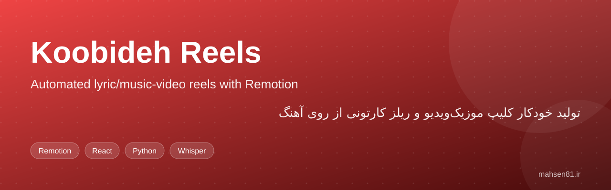
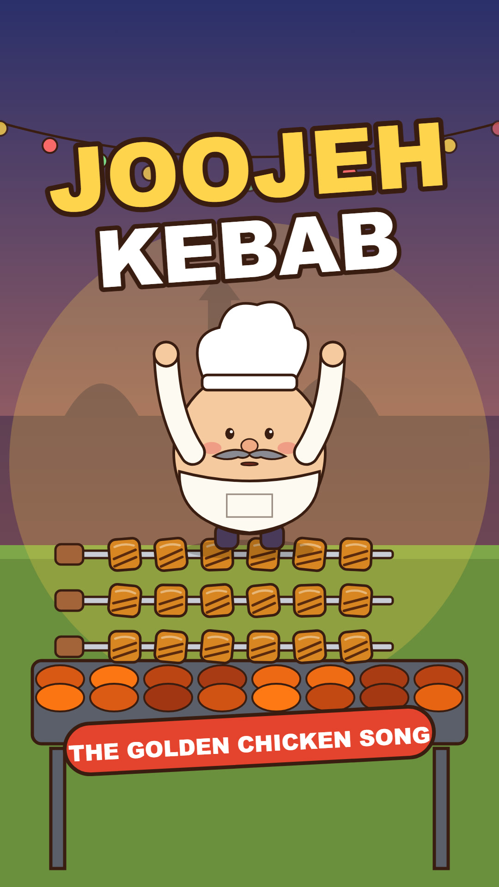

<!-- gen:header -->
<p align="center"></p>

<h1 align="center">Koobideh Reels</h1>
<p align="center"><b>تولید خودکار کلیپ موزیک‌ویدیو و ریلز کارتونی از روی آهنگ</b><br><i>Automated lyric/music-video reels with Remotion</i></p>
<p align="center">   </p>

<div dir="rtl">

## ✨ امکانات

- هم‌گام‌سازی متن با ضرب آهنگ
- قالب ویدیو با یک فایل تنظیمات
- رندر عمودی برای ریلز و شورتز

</div>

## 📸 تصاویر · Screenshots

<p align="center"> </p>

## 🚀 Quick start

```bash
cd work/video && npm i && npm run studio
```

---

<p align="center">ساخته‌شده توسط <a href="https://mahsen81.ir"><b>محسن جباره‌اصل</b></a> — برنامه‌نویسی، طراحی سایت، ربات و هوش مصنوعی<br>
Built by <a href="https://mahsen81.ir">Mohsen Jabbareh-Asl</a> · ⭐ اگر مفید بود، ستاره بدهید · Need a custom version? <a href="https://mahsen81.ir">Get in touch</a></p>
